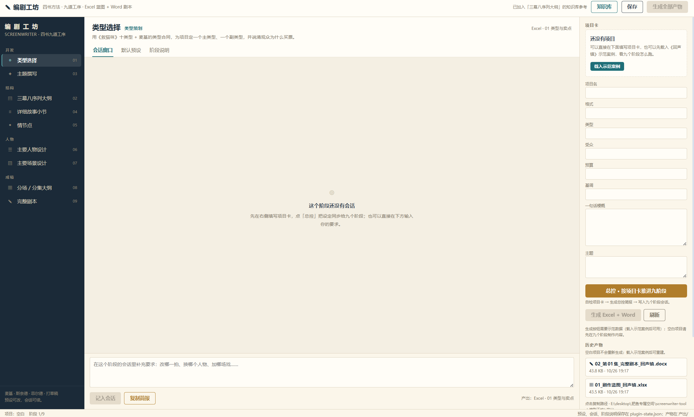

# ✎ 编剧工坊 / Screenwriter Studio

把四本编剧书变成一条可执行的流水线：**九个阶段、九份默认预设、九个可编辑会话窗口**，
最终产出两类文件——**Excel 剧作蓝图**（参照《打草稿》的工作表）与 **Word 完整剧本**
（参照悉德·菲尔德的格式）。

这是一个 DSH（DeepSeek Harness）插件 + 示范项目 + 方法库的组合。仓库内置原创示范项目
《回声镇》（12 集社会派悬疑短剧），载入后可以直接看到九个阶段跑通后的完整结果。



> 讲解版 PPT：[`产出/操作指南/编剧工坊_三块工作区操作指南.pptx`](产出/操作指南/编剧工坊_三块工作区操作指南.pptx)
>
> 交接 / macOS 迁移：[`HANDOFF.md`](HANDOFF.md)　｜　插件说明：[`plugin/README.md`](plugin/README.md)

---

## 1. 这是什么

| 组成 | 位置 | 作用 |
|---|---|---|
| 插件包 | [`plugin/`](plugin/) | DSH 宿主半 + 浏览器半：工具、技能、`/screenwriter/*` 路由、三栏工作台 |
| 示范项目 | [`demo/`](demo/) | 《回声镇》的项目数据与第 1 集完整剧本 JSON |
| 方法库 | [`知识库/`](知识库/) | 四书方法提要、章节页码依据、OCR 原文 |
| 产物 | [`产出/`](产出/) | 示例 Excel/Word，以及操作指南 PPT |
| 交接文档 | [`HANDOFF.md`](HANDOFF.md) | 架构、验证记录、跨平台迁移清单 |

当前功能：

- **初始空白**：项目卡、九个会话、总控简报默认都为空；《回声镇》需要手动「载入示范案例」。
- **右栏项目卡 + 总控**：填项目信息，先本地自检，再把项目卡写成九份 brief 广播到九个阶段。
- **九道工序**：类型、三幕八序列、主题、小节、情节点、人物、场景、分场分集、完整剧本。
- **三个工作页**：会话窗口（记要求 / 复制简报）、默认预设（可改可重置）、阶段说明。
- **阶段说明三块可编辑**：交付前必须回答、本阶段依据、知识库参考，均可逐条改 / 删 / 加。
- **知识库 + 本地 OCR**：上传 `.md/.txt/.docx/.pdf`；扫描版 PDF 用 RapidOCR 在本机取字，不联网。
- **确定性产物**：Excel 14 张可见表 + Word 13 页剧本，由 Python 脚本生成，不靠模型转述。

---

## 2. 仓库结构

```text
编剧工坊/
├─ README.md                      ← 本文件
├─ HANDOFF.md                     ← 交接与 macOS 迁移说明
├─ LICENSE
├─ requirements.txt               ← Excel/Word 引擎依赖
├─ requirements-ocr.txt           ← 扫描 PDF OCR 依赖
├─ demo/
│  ├─ 项目数据.json               ← 14 张表的结构化数据
│  └─ 剧本_第01集.json            ← 14 场剧本正文
├─ 知识库/
│  ├─ 00_四书整合_创作流程.md
│  ├─ 01_故事_麦基.md
│  ├─ 02_救猫咪_斯奈德.md
│  ├─ 03_电影剧本写作基础_菲尔德.md
│  ├─ 04_打草稿_编剧思维训练表.md
│  └─ _ocr_打草稿/                ← 原书 p9—192 的 OCR 原文（核对页码用）
├─ plugin/
│  ├─ package.json                ← @fatfish/screenwriter-studio
│  ├─ cordis.patch.yml            ← 注册到 DSH profile
│  ├─ SKILL.md                    ← 注册给模型的技能说明
│  ├─ presets/stages.json         ← 九阶段默认预设
│  ├─ lib/host.js                 ← 工具 / 技能 / 路由
│  ├─ lib/client.js               ← 三栏工作台
│  └─ engine/
│     ├─ build_xlsx.py            ← 项目 JSON → 剧作蓝图
│     ├─ build_docx.py            ← 剧本 JSON → Word
│     ├─ ingest_knowledge.py      ← 上传文件 → 文本摘录
│     └─ ocr_pdf.py               ← 扫描 PDF → 文字
└─ 产出/
   ├─ 01_剧作蓝图_回声镇.xlsx
   ├─ 02_第01集_完整剧本_回声镇.docx
   └─ 操作指南/
      ├─ 编剧工坊_三块工作区操作指南.pptx
      └─ assets/                  ← README / PPT 用的界面截图
```

> 仓库不包含四本编剧书的 PDF 原文件，只保留方法提要与 OCR 原文摘录，避免版权文件进入仓库。

---

## 3. 快速开始（新机器）

### 3.1 前置

- 已安装并登录 **DSH Desktop**（插件引擎要求 `@deepseek-ai/dsh >= 0.2.0-rc.2`）。
- **Git**。
- Python：
  - **Excel / Word 引擎**：`openpyxl`、`python-docx`，可用 DSH 自带 Python 3.12。
  - **OCR**：`pymupdf`、`rapidocr_onnxruntime`、`onnxruntime`、`opencv-python`；当前锁定的
    `.pylibs` 是 **Python 3.10** 构建，所以 OCR 默认走 Python 3.10。
- 两套依赖互不影响：Excel/Word 用 DSH Python，OCR 用 `SCREENWRITER_OCR_PYTHON` 指定的 Python。

```powershell
git clone <this-repo-url> 编剧工坊
cd 编剧工坊
```

### 3.2 安装 Excel/Word 依赖

```powershell
# 用 DSH 自带 Python（Windows 默认位置）
$py = "$env:USERPROFILE\.dsh\dsh-runtimes\dsh-primary-runtime\dependencies\python\python.exe"
& $py -m pip install -r requirements.txt
```

### 3.3 安装 OCR 依赖（只在上传扫描 PDF 时需要）

推荐单独建 Python 3.10 venv，再装 OCR 依赖：

```powershell
py -3.10 -m venv .venv-ocr
.\.venv-ocr\Scripts\python.exe -m pip install -r requirements-ocr.txt
```

然后把 `.venv-ocr\Scripts\python.exe` 配到 `SCREENWRITER_OCR_PYTHON`。
如果你已经有 `course-kit/.pylibs`（本机开发时就是复用它的），也可以直接指向它，
不用重复安装。

### 3.4 安装插件到 DSH

在 DSH 会话里用 `plugin_manager`：

```text
plugin_manager action=install_bundle target=<绝对路径>\编剧工坊\plugin
```

安装完成后**重启一次 DSH**（宿主半会被 ESM 缓存），刷新页面；侧栏出现 **✎ 编剧工坊**。
如果只改了浏览器半，刷新页面即可；只改了引擎脚本，下次点「生成」立即生效。

### 3.5 环境变量

| 变量 | 作用 | 默认 |
|---|---|---|
| `SCREENWRITER_HOME` | 数据根（插件被复制安装时指回本仓库） | 插件目录的上一级 |
| `SCREENWRITER_PYTHON` | Excel/Word 引擎 Python | DSH 自带 Python |
| `SCREENWRITER_OCR_PYTHON` | OCR Python（需 3.10 或与依赖匹配） | `Python310/python.exe` |
| `SCREENWRITER_OCR_LIBS` | OCR 依赖目录 | `<工作区>/course-kit/.pylibs` |
| `SCREENWRITER_OCR_PAGES` | 单次上传最多 OCR 多少页，0 = 整本 | `120` |
| `SCREENWRITER_FONT_SANS` | 图表/剧本标题字体 | 平台默认 |
| `SCREENWRITER_FONT_SERIF` | 剧本正文字体 | 平台默认 |

macOS 示例：

```bash
export SCREENWRITER_HOME="/Users/<you>/.../编剧工坊"
export SCREENWRITER_PYTHON="$SCREENWRITER_HOME/.venv/bin/python"
export SCREENWRITER_OCR_PYTHON="$SCREENWRITER_HOME/.venv-ocr/bin/python"
export SCREENWRITER_OCR_LIBS="$SCREENWRITER_HOME/vendor/pylibs"
export SCREENWRITER_FONT_SANS="PingFang SC"
export SCREENWRITER_FONT_SERIF="Songti SC"
```

### 3.6 验证

先绕过 DSH，直接跑两个引擎：

```powershell
$py = "$env:USERPROFILE\.dsh\dsh-runtimes\dsh-primary-runtime\dependencies\python\python.exe"

& $py plugin/engine/build_xlsx.py `
  --project demo/项目数据.json `
  --out "产出/01_剧作蓝图_回声镇.xlsx"

& $py plugin/engine/build_docx.py `
  --script demo/剧本_第01集.json `
  --out "产出/02_第01集_完整剧本_回声镇.docx"
```

两个都输出 `{"ok": true, ...}` 才继续。然后在 DSH 里：

1. 刷新页面，侧栏打开「编剧工坊」；
2. 确认初始项目卡为空；
3. 点「载入示范案例」，看九个阶段与两份产物；
4. 点「总控」，确认自检弹窗与简报写入；
5. 上传一份 PDF/Word，挂到某个阶段的「知识库参考」；
6. 点「保存」→「生成全部产物」。

---

## 4. 界面与操作

### 左栏 · 九道工序

四个阶段、九个工序。点任意一项，中栏切换到该阶段。编号 01—09 是推荐顺序。

### 中栏 · 三个工作页

- **会话窗口**：写补充要求、看总控简报、复制完整 brief 给子智能体。
- **默认预设**：这一页就是交给子智能体的 brief，可改、可重置。
- **阶段说明**：三块都能逐条编辑——
  - 交付前必须回答（`questions[]`）
  - 本阶段依据（`basis[]`）
  - 知识库参考（`kbRefs[]`，从知识库挂载 / 单独移除）

改完点顶栏「保存」，写入 `plugin-state.json`，并进入该阶段简报。

### 右栏 · 项目卡与总控

- 项目名、格式、类型、受众、预算、基调、一句话梗概、主题。
- **总控**：本地自检 → 有问题弹窗（返回修改 / 仍然继续）→ 把项目卡写成九份简报，
  写入九个阶段会话。总控只广播 brief，不直接生成剧本正文。
- **生成 Excel + Word**：需要结构化数据；空白项目按钮不可用，载入示范案例后可用。
- **载入示范案例 / 清空演示**：在空白项目与《回声镇》之间切换。

### 顶栏 · 知识库与 OCR

- 上传 `.md / .txt / .docx / .pdf`，单文件 ≤ 30 MB。
- 文字版 PDF 直接读文字层；扫描页才逐页 OCR（RapidOCR，本地 CPU，不联网）。
- 默认最多 OCR 120 页，超出部分会跳过并在结果里报数；用 `SCREENWRITER_OCR_PAGES` 调整。
- 上传完还要在「阶段说明 → 知识库参考 → + 从知识库添加」挂到具体阶段，才会进入该阶段简报。

---

## 5. 九阶段与四本书的分工

| # | 阶段 | 主责方法 | 产出 |
|---|---|---|---|
| 1 | 类型选择 | 《救猫咪》十类型 + 麦基类型合同 | 01 类型与卖点 |
| 2 | 三幕八序列大纲 | 麦基序列层级 + 菲尔德 25/50/25 | 03 三幕八序列 |
| 3 | 主题撰写 | 麦基控制性理念 + 反理念 | 主题陈述 + 三个主题场 |
| 4 | 详细故事小节 | 斯奈德 15 节拍 | 04 十五节拍 |
| 5 | 情节点 | 菲尔德情节点Ⅰ/Ⅱ + 麦基危机 | 05 情节点 / 05b 伏笔回馈 |
| 6 | 主要人物设计 | 打草稿角色表 + 麦基人物维 | 06 人物设计 / 07 人物关系 |
| 7 | 主要场景设计 | 菲尔德场景 + 麦基潜文本 | 08 主要场景 |
| 8 | 分场 / 分集大纲 | 打草稿“一幕接一幕” + 斯奈德钩子 | 09 分集大纲 / 10 第 1 集分场 |
| 9 | 完整剧本 | 菲尔德格式 + 麦基鸿沟 | 02 完整剧本.docx |

四书方法提要（含章节与页码依据）在 [`知识库/`](知识库/)；《打草稿》原书 p9—192 的 OCR
原文在 [`知识库/_ocr_打草稿/`](知识库/_ocr_打草稿/)，用来核对表格字段与页码。

---

## 6. 数据与产物

### `demo/项目数据.json`

主要字段：

```text
project, genre_analysis, acts[8], beats[15], plot_points[5],
characters[9], relationships{codes,edges[],matrix[]},
scenes[10], episodes[12], ep1_scenes[14], tension_curve[12]
```

### `demo/剧本_第01集.json`

```text
title, episode, episode_title, format, draft, date, logline,
characters[], scenes[{heading, elements[{type,text}]}]
type: action | character | parenthetical | dialogue | transition
```

### 产物

- `产出/01_剧作蓝图_回声镇.xlsx`：14 张可见表 + 1 张隐藏曲线数据表；一页一张表。
- `产出/02_第01集_完整剧本_回声镇.docx`：封面、人物表、14 场正文、页码，共 13 页。
- 生成走 `build_xlsx.py` / `build_docx.py`，结构、字体、页边距都由脚本决定。

---

## 7. 开发与改动

```powershell
# 语法
$node = "$env:USERPROFILE\.dsh\dsh-runtimes\dsh-primary-runtime\dependencies\node\bin\node.exe"
& $node --check plugin/lib/client.js
& $node --check plugin/lib/host.js

# Python 语法
$py = "$env:USERPROFILE\.dsh\dsh-runtimes\dsh-primary-runtime\dependencies\python\python.exe"
& $py -m py_compile plugin/engine/build_xlsx.py plugin/engine/build_docx.py plugin/engine/ingest_knowledge.py plugin/engine/ocr_pdf.py
```

常见改动位置：

| 想改什么 | 改哪里 |
|---|---|
| 故事内容 | `demo/项目数据.json`、`demo/剧本_第01集.json` |
| 九阶段默认预设 / 自检问题 | `plugin/presets/stages.json` |
| Excel 表结构、列宽、配色 | `plugin/engine/build_xlsx.py` 顶部常量 |
| Word 剧本格式、字体、页边距 | `plugin/engine/build_docx.py` |
| 工作台布局 / 交互 | `plugin/lib/client.js` |
| 工具、路由、项目卡自检 | `plugin/lib/host.js` |
| 知识库取字 / OCR | `plugin/engine/ingest_knowledge.py`、`plugin/engine/ocr_pdf.py` |

宿主半改动需要重启 DSH；浏览器半刷新页面；引擎脚本改完下一次生成立即生效。

---

## 8. 已知边界

- **不直接调用模型**：总控只做自检与 brief 广播；真正的正文创作在会话里完成。
- **空白项目不能直接生成**：Excel/Word 需要结构化数据，先载入示范案例或导入自己的项目 JSON。
- **OCR 是同步上传**：页数多时请求会久；默认 120 页是速度与完整度的折中。
- **OCR 依赖不随仓库分发**：需要本机有 Python 3.10 依赖，或设置 `SCREENWRITER_OCR_LIBS`
  指向已有的 `.pylibs`；否则只支持文字版 PDF/docx/txt/md。
- **macOS 未做截图级验收**：代码已按平台选字体与 Python 候选；迁移前请按 `HANDOFF.md` 跑一遍。
- **演示剧本体量**：14 场、约 2,900 字，结构与格式完整，对白可继续加厚。

---

## 9. License

MIT。见 [`LICENSE`](LICENSE)。
